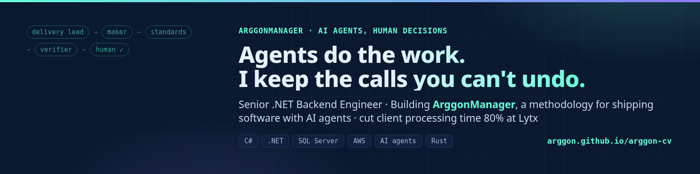

### Hi, I'm Gonzalo. I cut client processing time by 80% with one endpoint.

Senior .NET backend engineer from Córdoba, Argentina. C#, .NET, SQL Server and AWS by day, Rust on the side. **Open to remote roles.**

## What I'm building: [ArggonManager](https://github.com/Arggon/ArggonManager)

A methodology for shipping software with AI agents, and the CLI that enforces it. Work items live in the repo as Markdown. Agents take roles (delivery lead, maker, standards, verifier), the paperwork scales with risk, and nothing is done until it passes the gate. The calls you can't undo stay with a human.

## Highlights

- **80% less client processing time (Lytx).** I designed a bulk endpoint: one batch request handed to a SQL Server stored procedure that processes the whole set in the database.
- **30% faster under load (Coalfire).** I moved critical endpoints from a monolith to a .NET 9 microservice.
- **Five-agent SDLC pipeline (Coalfire).** Meeting to specs, specs to tasks, PR, Playwright QA, tech-lead review. Any failed check sends the work back.

## Stack

    

## Other projects

- [racha](https://github.com/Arggon/racha): a habit tracker with streaks. Rust CLI, local data, desktop notifications.
- Labs built by my agents, under my specs and review: [suizo](https://github.com/Arggon/suizo), [guardian](https://github.com/Arggon/guardian), [estanteria](https://github.com/Arggon/estanteria).

## Find me

[Site and CV](https://arggon.github.io/arggon-cv/) · [LinkedIn](https://www.linkedin.com/in/arggon) · [X @arggondev](https://x.com/arggondev) · arggondev@gmail.com
